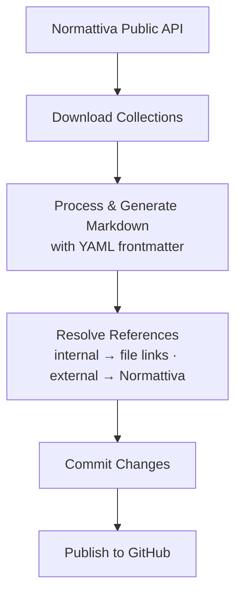
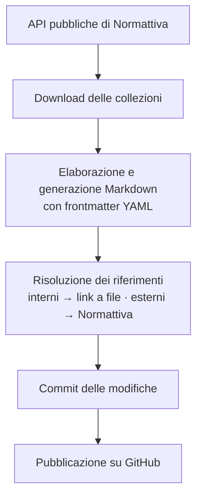

# 🇮🇹 Italia Corpus

**Un corpus verificabile della legislazione italiana in Markdown, derivato dalle collezioni disponibili su Normattiva.**

[License: MIT](https://opensource.org/licenses/MIT)
[Data: Public Domain](https://www.normattiva.it)
[Updates: Daily](#aggiornamenti)
[Source: Normattiva](https://www.normattiva.it)

---


| 📄 Atti   | 🗂️ Collezioni     | 💾 Dimensione | 🔄 Aggiornamenti |
| --------- | ------------------ | ------------- | ---------------- |
| Vedi `manifest.json` | Vedi `manifest.json` | Snapshot scaricabili | Verifica quotidiana |


[🇬🇧 English](#english) · [🇮🇹 Italiano](#italiano)

---

## English

### What this project is

**Italia Corpus Legale** is a public dataset derived from the collections made available by [Normattiva](https://www.normattiva.it) and distributed as **Markdown**. Coverage is measured in `manifest.json`; it is not described as complete unless the manifest proves it.

> Each canonical act is one file. Every published commit is one fully validated snapshot.

---

### Why it exists

Italian legislation is technically public, but in practice it is hard to use:


| Problem                                    | Status   |
| ------------------------------------------ | -------- |
| Proprietary formats or hard-to-parse HTML  | ✅ Solved |
| No ready-to-use dataset for model training | ✅ Solved |
| No AI-friendly version of the law in force | ✅ Solved |


---

### How it is produced

The corpus is generated by an **open-source Python script** available at [github.com/ahmeabd/italia-corpus-script](https://github.com/ahmeabd/italia-corpus-script). It runs the following pipeline:



Each run only produces **real diffs** — if a collection has not changed, no commit is created.

---

### File format & frontmatter

Every file in the corpus begins with a YAML frontmatter block that carries structured metadata:

```yaml
---
tipo: DECRETO-LEGGE
numero: 216
data: 1993-07-06
titolo: "Adempimenti finanziari per l'attuazione del regolamento CEE n. 880/92 sul marchio di qualita' ecologica - Ecolabel."
urn: urn:nir:stato:decreto.legge:1993-07-06;216
codice_redazionale: 093G0287
vigente: true
---
```

This metadata is designed to enable seamless integration across a broad range of services:


| Field                | Purpose                                                |
| -------------------- | ------------------------------------------------------ |
| `tipo`               | Act type — enables filtering by legislative instrument |
| `numero` + `data`    | Temporal ordering and point-in-time queries            |
| `titolo`             | Full-text title search                                 |
| `urn`                | Stable, canonical reference (NIR standard)             |
| `codice_redazionale` | Cross-reference key used by Normattiva                 |
| `vigente`            | In-force flag for filtering only current law           |


**References:** cross-references to other acts in this corpus are resolved internally (file-to-file links). References to acts not present in the corpus are redirected to the [Normattiva](https://www.normattiva.it) platform.

---

### Use cases


| Use case            | How to use this repo                                              |
| ------------------- | ----------------------------------------------------------------- |
| **Legal RAG**       | Index `.md` files with a vector store (Chroma, Pinecone, Qdrant…) |
| **LLM fine-tuning** | Use the corpus as domain-specific training text                   |
| **Benchmarks**      | Build Q&A from articles to evaluate legal models                  |
| **Research**        | Linguistic analysis, NLP, citation graphs of Italian law          |
| **Case law**        | Link normative texts with court decisions                         |


---

### Quick start

```bash
git clone https://github.com/ahmeabd/italia-corpus.git
cd italia-corpus
```

**Index with LangChain:**

```python
from langchain_community.document_loaders import DirectoryLoader, UnstructuredMarkdownLoader

loader = DirectoryLoader(
    "italia-corpus/",
    glob="**/*.md",
    loader_cls=UnstructuredMarkdownLoader
)
docs = loader.load()
```

---

### Updates

The corpus is updated automatically whenever Normattiva publishes changes, with **daily checks**.

Each legislative difference corresponds to a **git commit** — meaning you can track the evolution of Italian law using standard git tools:

```bash
git log --oneline          # see all legislative updates
git blame <file>.md        # see when each line was last changed
git diff HEAD~1            # inspect the latest normative diff
```

---

### Technical details


| Parameter       | Value                                                                         |
| --------------- | ----------------------------------------------------------------------------- |
| Format          | Markdown (`.md`) with YAML frontmatter                                        |
| Encoding        | UTF-8                                                                         |
| Primary source  | [normattiva.it](https://www.normattiva.it)                                    |
| Updates         | Automatic, diff-driven                                                        |
| Content license | Public data                                                                   |
| Script license  | MIT — [italia-corpus-script](https://github.com/ahmeabd/italia-corpus-script) |


---

### Contributing

Found a parsing error, a missing file, or have ideas to improve the project? See [CONTRIBUTING.md](CONTRIBUTING.md) for guidelines.

---

### Legal notice

Italian legislative texts are public acts of the State and may be freely reproduced under **Article 5 of the Copyright Act (Law 633/1941)**.

This repository is **not affiliated with or sponsored by** Normattiva or the Italian government.

> [!WARNING]
> Texts are provided **without warranty of completeness or real-time currency**. For legal or professional use, always refer to the *Gazzetta Ufficiale*.

---

### Author

Built by [ahmeabd](https://github.com/ahmeabd).
If this project helps you, **leave a star** ⭐ — it helps more developers find it.

---

*Because the law belongs to everyone. Finally its data does too.*

---

---

## Italiano

### Cos'è questo progetto

**Italia Corpus Legale** è un dataset pubblico derivato dalle collezioni rese disponibili da [Normattiva](https://www.normattiva.it) e distribuito in formato **Markdown**. La copertura effettiva è misurata in `manifest.json` e non viene dichiarata completa senza verifica.

> Ogni atto canonico è un file. Ogni commit pubblicato è uno snapshot completo e validato.

---

### Perché esiste

La legislazione italiana è tecnicamente pubblica, ma nella pratica è inaccessibile:


| Problema                                             | Stato     |
| ---------------------------------------------------- | --------- |
| Formati proprietari o HTML difficile da parsare      | ✅ Risolto |
| Nessun dataset pronto per il training di modelli     | ✅ Risolto |
| Nessuna versione AI-friendly della normativa vigente | ✅ Risolto |


---

### Come viene generato

Il corpus è prodotto da uno **script Python open source** disponibile su [github.com/ahmeabd/italia-corpus-script](https://github.com/ahmeabd/italia-corpus-script), che esegue la seguente pipeline:



Ogni esecuzione produce solo i **diff reali** — se una collezione non è cambiata, nessun commit viene generato.

---

### Formato dei file e frontmatter

Ogni file del corpus inizia con un blocco YAML frontmatter contenente metadati strutturati:

```yaml
---
tipo: DECRETO-LEGGE
numero: 216
data: 1993-07-06
titolo: "Adempimenti finanziari per l'attuazione del regolamento CEE n. 880/92 sul marchio di qualita' ecologica - Ecolabel."
urn: urn:nir:stato:decreto.legge:1993-07-06;216
codice_redazionale: 093G0287
vigente: true
---
```

Questi metadati sono progettati per consentire un'integrazione diretta in una vasta gamma di servizi:


| Campo                | Scopo                                                         |
| -------------------- | ------------------------------------------------------------- |
| `tipo`               | Tipo di atto — permette il filtraggio per strumento normativo |
| `numero` + `data`    | Ordinamento temporale e query puntuali nel tempo              |
| `titolo`             | Ricerca full-text per titolo                                  |
| `urn`                | Riferimento stabile e canonico (standard NIR)                 |
| `codice_redazionale` | Chiave di riferimento incrociato usata da Normattiva          |
| `vigente`            | Flag di vigenza per filtrare solo la normativa in vigore      |


**Riferimenti:** i riferimenti incrociati ad altri atti presenti nel corpus vengono risolti internamente (link file-to-file). I riferimenti ad atti non presenti nel corpus vengono reindirizzati alla piattaforma [Normattiva](https://www.normattiva.it).

---

### Casi d'uso


| Caso d'uso          | Come usare questo repo                                                 |
| ------------------- | ---------------------------------------------------------------------- |
| **RAG legale**      | Indicizza i file `.md` con un vector store (Chroma, Pinecone, Qdrant…) |
| **Fine-tuning LLM** | Usa il corpus come dataset di testo domain-specific                    |
| **Benchmark**       | Crea Q&A basate sugli articoli per valutare modelli legali             |
| **Ricerca**         | Analisi linguistica, NLP, citation graph della normativa italiana      |
| **Giurisprudenza**  | Collegamento tra testi normativi e sentenze                            |


---

### Utilizzo rapido

```bash
git clone https://github.com/ahmeabd/italia-corpus.git
cd italia-corpus
```

**Indicizza con LangChain:**

```python
from langchain_community.document_loaders import DirectoryLoader, UnstructuredMarkdownLoader

loader = DirectoryLoader(
    "italia-corpus/",
    glob="**/*.md",
    loader_cls=UnstructuredMarkdownLoader
)
docs = loader.load()
```

---

### Aggiornamenti

Il corpus viene aggiornato automaticamente ogni volta che Normattiva pubblica modifiche, con **controlli giornalieri**.

Ogni differenza normativa corrisponde a un **commit git** — il che significa che puoi seguire l'evoluzione della legislazione italiana con i normali strumenti git:

```bash
git log --oneline          # visualizza tutti gli aggiornamenti normativi
git blame <file>.md        # vedi quando ogni riga è stata modificata l'ultima volta
git diff HEAD~1            # analizza l'ultimo diff normativo
```

---

### Dati tecnici


| Parametro         | Valore                                                                        |
| ----------------- | ----------------------------------------------------------------------------- |
| Formato           | Markdown (`.md`) con frontmatter YAML                                         |
| Encoding          | UTF-8                                                                         |
| Fonte primaria    | [normattiva.it](https://www.normattiva.it)                                    |
| Aggiornamento     | Automatico, guidato da diff                                                   |
| Licenza contenuti | Dati pubblici                                                                 |
| Licenza script    | MIT — [italia-corpus-script](https://github.com/ahmeabd/italia-corpus-script) |


---

### Contribuire

Hai trovato un errore nel parsing, un file mancante o hai idee su come migliorare il progetto? Consulta il file [CONTRIBUTING.md](CONTRIBUTING.md) per le linee guida.

---

### Note legali

I testi normativi italiani sono atti pubblici dello Stato e come tali liberamente riproducibili ai sensi dell'**art. 5 della Legge sul diritto d'autore (L. 633/1941)**.

Questa repository **non è affiliata né sponsorizzata** da Normattiva o dal Governo italiano.

> [!WARNING]
> I testi sono forniti **senza garanzia di completezza o aggiornamento in tempo reale**. Per uso legale o professionale fare sempre riferimento alla *Gazzetta Ufficiale*.

---

### Autore

Realizzato da [ahmeabd](https://github.com/ahmeabd).
Se questo progetto ti è utile, **lascia una stella** ⭐ — aiuta il progetto a raggiungere più sviluppatori.

---

*Perché la legge è di tutti. Finalmente anche il suo dato.*
